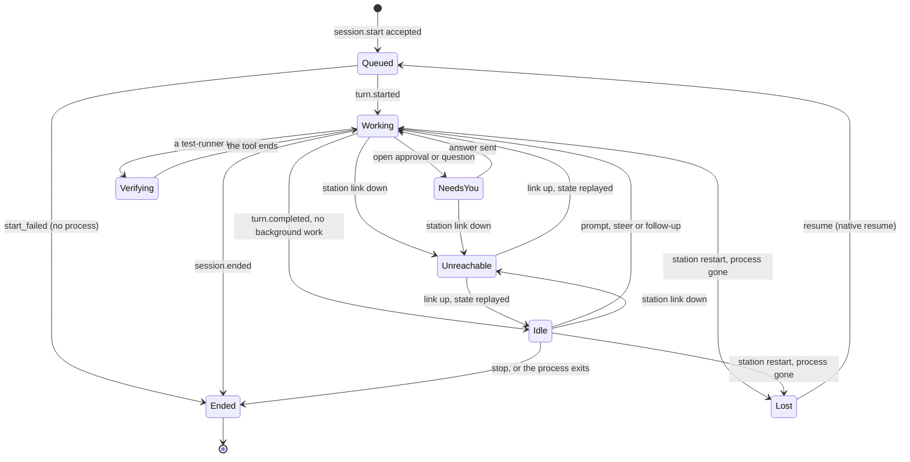

# Fleet Deck v2 internals

This document is the map of the v2 code for a developer and a reviewer. It gives the glossary, the crate map, the data flow, the link protocol and the durability rules. The binding contracts are in [PLAN.md](./PLAN.md) and the ADRs in [adr/](./adr/); this document points to them and does not change them.

## 1. Glossary

| Term | Meaning |
| --- | --- |
| **deck** | The hub node. It serves the board, keeps the fleet state and routes commands to the stations. One for each owner. |
| **station** | The worker node on a machine. It runs the provider processes and owns the worktrees, files, checkpoints and the session event log. |
| **board** | The web client (React, TypeScript) in `web/`. It talks only to the deck. |
| **link** | The mutual-TLS connection between a deck and a station: one control WebSocket and one data WebSocket (ADR-004). |
| **provider** | An agent CLI: Claude Code (`claude`, stream-json control protocol, ADR-001) or Codex (`codex app-server`, JSON-RPC, ADR-002). |
| **provider instance** | A configured provider on a station: `id`, `driver`, `binary`, `config_home`, `env` (`station.toml`). |
| **adapter** | The code that turns a provider's native protocol into canonical events and commands into native messages (`fleetdeck-providers`). The adapter cores are sans-IO. |
| **session host** | The layer that owns the provider process: `DirectChildHost` (the agent is a child of the station) or `ShimHost` (the agent runs under a `fleetdeck shim` process and survives a station restart, ADR-005). |
| **shim** | The small `fleetdeck shim` process that holds one provider process, buffers its output, writes its stdin by frame id, and reports its exit. |
| **session / run / turn** | A session is one agent conversation. A run is the work that one input starts. A turn is one provider turn inside a run. |
| **canonical event** | A provider-neutral event (`fleetdeck_proto::event::Event`) with a station sequence (`station_seq`) and a session sequence (`session_seq`). Unknown kinds round-trip unchanged. |
| **command / receipt** | A mutating request with a ULID `command_id`. The station decides it once and stores an accept or reject receipt; a retry gets the same receipt. |
| **effect** | An outbox row that a decision stores for the external I/O (start, prompt, answer, stop, revert, resume). States: `queued`, `claimed`, `confirmed`, `retired_not_dispatched`, `outcome_unknown`. |
| **incarnation** | The id of one station database. A restore makes a new one; a command for another incarnation is refused. |
| **outcome_unknown** | The station cannot prove whether the provider received an input. It never resends it. |
| **lost** | A session whose process the station cannot account for after a restart. |
| **checkpoint** | A snapshot of the workspace at a turn boundary, for revert (PLAN §6.6). |
| **callsign** | A short session name, unique on its station; the address for mail and tasks. |
| **workspace** | The directory where a session works: the repository itself, a new git worktree, or a clone. The station provisions it (`workspace/provision.rs`). |
| **mail / task** | Deck-side fleet records: a message from one session to another (delivered as input through the outbox), and a unit of work that the deck assigns to a session. |
| **coordinator grant** | A scoped, expiring permission that lets one session start and steer other sessions through the coordinator MCP API (ADR-006). The owner renews or revokes it. |
| **drain** | A station mode that refuses new work before an upgrade (DL-128). |
| **auto-continue** | An opt-in per-session preference: after a station restart, continue a lost turn with a fixed station message when every ADR-007 rule holds. |

## 2. Crate map

| Crate | What is in it |
| --- | --- |
| `fleetdeck-core` | Ids (ULID), clock, `Secret<T>`, identity keys, `station.toml` and `deck.toml`, directories, SQLite with migrations (`Db`), logging. |
| `fleetdeck-proto` | The wire types: events and the fold into `SessionSummary`, commands and receipts, link frames, versions and features, plans, input, conflicts, shell types. `make ts-types` exports them to `web/src/gen`. |
| `fleetdeck-providers` | The adapter traits, the Claude and Codex adapters, capabilities, checkpoints of the adapter cores, `DirectChildHost` and the shim (`host/shim/`: wire frames, launch, server, stdin, host). |
| `fleetdeck-station` | The station: `store/` (event log, receipts, effects, recovery, shims, reverts, auto-continue facts), `manager/` (decide, session targets, effect worker, durable drivers, resume, revert, auto-continue, drain), workspace service, policy, shell service, local socket, `serve.rs`, `upgrade.rs`. |
| `fleetdeck-link` | TLS from identity keys, the handshake, pairing, the control and data channels, the method table with scopes and features, reconnect. |
| `fleetdeck-deck` | The deck: registry of stations, read model, fleet services (mail, tasks, plans, routing, conflicts, usage), outbox, auth and audit, HTTP and WebSocket API, the embedded board. |
| `fleetdeck-cli` | The `fleetdeck` binary: `up`, `deck`, `station`, `open`, and the hidden `shim` and `shim-exec` commands. |
| `fleetdeck-testkit` | Fake agents (`fake-claude`, `fake-codex`), recorders, the deterministic clock and ids, temporary nodes, fault injection. |

## 3. Data flow of one command

1. The board sends a command to the deck API. The deck checks the login, the scope and the CSRF token, gives the command a `command_id`, stores it as `pending` and sends it over the link.
2. The station's command router calls `SessionManager::submit`. Guards run first (auto-continue enable, drain).
3. `Store::decide` runs the decision in one SQLite transaction: it checks the policy and the session state, appends the events, stores the effects and the receipt (`manager/decide.rs`). A rejection is stored as a receipt too.
4. The effect worker claims the effect and does the external I/O through the session target (`manager/target.rs`): spawn, write to stdin, answer an approval. It confirms the effect or marks it `outcome_unknown`.
5. The adapter turns the provider output into canonical events. The station appends them to the event log.
6. The link sends the events to the deck with their `station_seq`. The deck folds them into its read model and acknowledges them after the commit.
7. The board receives the change over its WebSocket.

## 4. Link protocol (summary of ADR-004)

- Transport: TLS (rustls) with self-signed certificates from Ed25519 identity keys, pinned after pairing. A control WebSocket (JSON frames up to 1 MiB) and a data WebSocket (byte streams with credit flow control).
- Handshake: both sides send `Hello { proto_min, proto_max, features, role, node_id, link_epoch, nonce }` and sign the transcript with the TLS exporter value. The highest common version wins; the features decide the behaviour.
- Frames: `Request`, `Response`, `Event`, `Ack`, `SnapshotBegin`/`SnapshotSession`/`SnapshotEnd`, `Ping`/`Pong`, `Close`.
- Each method declares its direction, scope and feature (`crates/fleetdeck-link/src/methods.rs`, ADR-004 §9.6). A method whose feature was not negotiated is refused `feature_not_negotiated`. Example: `coordinator.query` and `coordinator.call` need `coordinator.v1`, so an N−1 peer without it cannot reach the coordinator forward (ADR-006 test 26).
- **Fleet Git methods** (ADR-009, additive; the table is `crates/fleetdeck-link/src/methods_table.rs`). The features are `fleet_git.v1`, `fleet_git.homes.v1`, `fleet_git.land.v1` and `fleet_git.branches.v1`. None is required. A deck does not act for a station without the feature: the board gets 409 `fleet_git_unsupported`. Besides the methods, the features cover the field `fleet_git` of `session.start`, the file root `artifacts` of `files.v1`, and the events `workspace.base_stale`, `workspace.include_skipped`, `session.push`, `session.cleanup`, `artifacts.ready`, `artifacts.unavailable`, `artifacts.revoked` and `session.land`.

| Method | Direction | Scope | Feature | What it does |
| --- | --- | --- | --- | --- |
| `fleet_git.projects_set` | deck to station | `admin` | `fleet_git.v1` | The versioned full snapshot of the project settings and homes. |
| `fleet_git.push_now` | deck to station | `drive` | `fleet_git.v1` | "Push now" for one session. |
| `project.ensure_home` | deck to station | `admin` | `fleet_git.homes.v1` | Clone or adopt a home. Idempotent by attempt id and request digest. |
| `project.home_status` | deck to station | `read` | `fleet_git.homes.v1` | The state of a home attempt (the deck polls it while a clone runs). |
| `fleet_git.artifact_authorize` | station to deck | `admin` | `fleet_git.homes.v1` | A station asks for the verdict of an artifact share on another machine. The scope is `admin` because a paired station holds only `admin` (STATION_SCOPES). |
| `fleet_git.share_verdict` | deck to station | `read` | `fleet_git.homes.v1` | The exporting station answers the exposure of one of its Taildrive shares. |
| `project.radar` | deck to station | `read` | `fleet_git.land.v1` | One run of the conflict radar on the radar home. |
| `session.land` | deck to station | `drive`, mutating | `fleet_git.land.v1` | The land of a session with a pinned plan and a stable command id. |
| `fleet_git.land_status` | deck to station | `read` | `fleet_git.land.v1` | The stored run of a land, also for a fenced land (so the deck gets the outcome fields). |
| `fleet_git.land_abandon` | deck to station | `drive` | `fleet_git.land.v1` | The fence of "Stop checking": the station waits for an active write, then fences the land id. |
| `project.branches` | deck to station | `read` | `fleet_git.branches.v1` | The `fd/` branches of the radar home (times in Unix milliseconds). |
| `project.fetch` | deck to station | `read` | `fleet_git.branches.v1` | One fetch on the radar home. |

- Commands carry `target_incarnation` and `retry_until`. The deck resends the same `command_id` after a reconnect and never after `retry_until`.
- Network scope: loopback, private LAN and tailnet addresses only (D13).

## 5. Durability rules

- **Event log first.** The station commits events, receipts and effects in one transaction before any external I/O.
- **Never resend.** An input whose fate is unknown stays `outcome_unknown`. A continuation is never a copy of an owner prompt.
- **Recovery at start.** `Store::recover` settles every claimed effect and every session with a live process from the last run. Under the direct host the processes died with the station, so their sessions become `lost`. Under the shim host, `recover_station` reattaches each shim with a higher generation, settles the stdin frames, restores the adapter checkpoints, and replays the output from the committed cursor.
- **Shim fencing.** Each attach advances a generation. Only the current generation commits output and moves the cursor; a shim acknowledges output only after the commit.
- **Revert.** A revert runs as a durable step machine (`reverts` table). A crash in a step that cannot be proven gives the state "reconciliation required", and input stays blocked.
- **Upgrade.** The snapshot of `station.db` (main, WAL, SHM) is taken while the station is stopped. After the new station opens the live database, a rollback never restores the snapshot.

## 6. Versions and compatibility

- Link: `proto_min..proto_max` plus feature flags. A deck and a station one build apart (N−1) use the shared features (`crates/fleetdeck-link/tests/version_skew.rs`).
- Stored data: new event fields use `#[serde(default)]`; unknown event kinds round-trip as `EventBody::Unknown`.
- Shim protocol: `wire::PROTOCOLS`; the station and a shim pick the highest common version. The trial of an upgrade refuses a build that cannot speak a running shim's protocol.
- Database: each migration list only grows. A database with a newer schema than the build refuses to open (`DbError::TooNew`).

## 7. Where the tests are

| Area | Tests |
| --- | --- |
| Decisions, effects, recovery | `crates/fleetdeck-station/src/manager/*tests.rs`, `crates/fleetdeck-station/src/store/*tests.rs` |
| Real station processes (SIGKILL, faults, local CLI, upgrade) | `crates/fleetdeck-cli/tests/station_*.rs` |
| ShimHost (ADR-005 §9) | `crates/fleetdeck-cli/tests/shim_*.rs`, `host::shim::tests`; the map is in `docs/v2/progress/m3-durable.md` |
| Adapters and recorded fixtures | `crates/fleetdeck-providers/tests/` |
| Link | `crates/fleetdeck-link/tests/` |
| Deck API and fleet services | `crates/fleetdeck-deck/tests/` |
| Board | `web/src/**/*.test.tsx` (unit), `web/e2e/*.spec.ts` (Playwright at a phone viewport against a fake deck) |
| Performance | `make perf` (`crates/fleetdeck-cli/tests/perf.rs`) |
| Live CLIs (opt-in) | `make smoke-live` ([LIVE-SMOKE.md](./LIVE-SMOKE.md)) |

## 8. Where each M3 feature lives

Use this table to find the code of a feature. The tests of a feature are next to its code, and its board flow is in `web/e2e/`.

| Feature | Station | Deck | Board |
| --- | --- | --- | --- |
| Workspaces (worktree, clone, batch) | `workspace/provision.rs`, `manager/workspaces.rs` | `http/workspace_routes.rs` | `web/src/spawn/`, `e2e/workspace.spec.ts`, `e2e/spawn.spec.ts` |
| Assign, tasks, mail | — | `store/fleet.rs`, `http/assign_routes.rs`, `http/fleet_routes.rs` | `web/src/assign/`, `web/src/fleet/`, `e2e/assign.spec.ts`, `e2e/fleet.spec.ts` |
| Coordinator MCP (ADR-006) | `coordinator/` (MCP ingress, bindings, tools, `forward.rs` link forward; `outbox.rs` durable coordinator outbox worker over `store/coordinator_outbox.rs`, station schema V17, states `pending|done|failed|ambiguous`, one envelope per command id and a 15 min `retry_until`, DL-218; `coordinator.query` and `coordinator.call` are gated by `coordinator.v1` in `crates/fleetdeck-link/src/methods.rs`), `manager/coordinator_command.rs` (`session.coordinator_renew`, `session.coordinator_revoke`; `check_spec` refuses a `SessionSpec.coordinator` that is not an owner start or whose provider handoff is unverified, DL-215), `coordinator/handoff.rs` (credential handoff into the child environment), `manager/coordinator_start.rs` (the start effect mints the credential, adds a `pending` binding at generation 0 and fails a resume, a shim-hosted start or a start without ingress or verified handoff, DL-216; `bound_events` and `ended_events` move the binding to bound at the native identity and revoke it at process exit, DL-217) | `store/coordinator.rs`, `store/coordinator_ops.rs`, `store/grants.rs`, `http/grant_routes.rs` (`owner_start` creates the grant with the deck-served control skill `control_skill.md`, schema V11 `tokens.start_command_id`, DL-217) | `web/src/session/commands.ts`, `web/src/fleet/FleetPanel.tsx` (grant renewal; in progress, lane B 6-5) |
| Plans | — | `store/plans.rs`, `http/plan_routes.rs` | `board/PlanLibrary.tsx`, `e2e/plans.spec.ts` |
| Usage meters | provider limits (`crates/fleetdeck-providers/src/codex/limits.rs`) | read model | `board/UsageMeters.tsx`, `e2e/usage.spec.ts` |
| Images and notifications | image input (`crates/fleetdeck-proto/src/input.rs`; Claude `control.rs`, Codex `rpc.rs`) | — | `session/` (images), `board/notify.ts`, `e2e/images.spec.ts` |
| Conflict radar | — (the deck reads the file touches from the events) | `store/conflicts.rs` | `board/ConflictRadar.tsx`, `e2e/conflicts.spec.ts` |
| Files, checkpoints, revert | `workspace/checkpoint.rs`, `workspace/restore.rs`, `manager/revert*.rs`, `manager/files.rs` | `http/file_routes.rs` | `web/src/session/`, `e2e/revert.spec.ts` |
| Import a CLI session | `manager/decide.rs` (`session.import`) | method table | `web/src/spawn/`, `e2e/spawn.spec.ts` |
| Human shell | `shell/`, `store/shell_effects.rs` (schema V16) | `http/shell_routes.rs` | `web/src/shell/`, `e2e/shell.spec.ts` |
| ShimHost | `manager/shim*.rs`, `store/shims.rs` | — | — |
| Auto-continue | `manager/auto_continue.rs`, `store/auto_continue.rs` | method table | `web/src/session/SessionView.tsx` |
| Drain and upgrade | `manager/drain.rs`, `upgrade.rs`, `local.rs` | — | — (CLI: `fleetdeck station drain`, `fleetdeck station upgrade`) |

The paths in the Station column are below `crates/fleetdeck-station/src/`, and the paths in the Deck column are below `crates/fleetdeck-deck/src/`, when no crate is named. The paths in the Board column are below `web/src/` or `web/`.

## 9. Board HTTP route map

The table is generated from the method table of the deck (`crates/fleetdeck-deck/src/http/methods.rs`). Regenerate it with `sh tools/route-map.sh` after a route change, and paste the output here. The deck guard refuses a route that is not in the table, so the table is complete by construction (DL-138, L15).

How to read it:
- **Scope** is the scope that a login or a token must hold. `none (login)` is for the two login routes.
- **Mutating** routes need the CSRF token of a cookie login and write an audit row.
- Some `admin` routes also need the owner's board login and refuse a token with `403 owner_only` (DL-138). They are the human shell (`shells.*`), the station pairing routes (`stations.add`, `stations.invite`, `stations.remove`), `auth.device_link`, `files.paste`, the worktree routes (`stations.worktrees`, `worktree.*`), the coordinator grant routes (`coordinator.revoke`, `coordinator.renew`), and a `session.start` that carries a setup command. The handler checks this, not the table.

| Name | Method | Route | Scope | Mutating |
| --- | --- | --- | --- | --- |
| `auth.login` | POST | `/api/auth/login` | none (login) | yes |
| `auth.link` | POST | `/api/auth/link` | none (login) | yes |
| `auth.logout` | POST | `/api/auth/logout` | read | yes |
| `auth.device_link` | POST | `/api/auth/device-link` | admin | yes |
| `auth.session` | GET | `/api/auth/session` | read | no |
| `stations.list` | GET | `/api/stations` | read | no |
| `stations.add` | POST | `/api/stations` | admin | yes |
| `stations.invite` | POST | `/api/stations/invite` | admin | yes |
| `stations.remove` | POST | `/api/stations/{station}/remove` | admin | yes |
| `stations.workspaces` | GET | `/api/stations/{station}/workspaces` | drive | no |
| `workspace.preflight` | POST | `/api/stations/{station}/workspace/preflight` | drive | yes |
| `files.paste` | POST | `/api/stations/{station}/paste` | admin | yes |
| `files.list` | GET | `/api/stations/{station}/files/list` | drive | no |
| `files.read` | GET | `/api/stations/{station}/files/read` | drive | no |
| `files.search` | GET | `/api/stations/{station}/files/search` | drive | no |
| `files.diff` | GET | `/api/stations/{station}/sessions/{session}/turns/{turn}/diff` | drive | no |
| `conflicts.list` | GET | `/api/conflicts` | read | no |
| `archive.list` | GET | `/api/archive` | read | no |
| `archive.change` | POST | `/api/archive` | drive | yes |
| `plans.list` | GET | `/api/plans` | read | no |
| `plans.mark` | POST | `/api/plans/mark` | drive | yes |
| `sessions.list` | GET | `/api/sessions` | read | no |
| `fleet.extras` | GET | `/api/fleet/extras` | read | no |
| `commands.list` | GET | `/api/commands` | read | no |
| `audit.list` | GET | `/api/audit` | admin | no |
| `commands.get` | GET | `/api/commands/{command_id}` | read | no |
| `board.ws` | GET | `/api/ws` | read | no |
| `stations.worktrees` | GET | `/api/stations/{station}/worktrees` | admin | no |
| `worktree.trash` | POST | `/api/stations/{station}/worktrees/trash` | admin | yes |
| `worktree.restore` | POST | `/api/stations/{station}/worktrees/restore` | admin | yes |
| `worktree.purge` | POST | `/api/stations/{station}/worktrees/purge` | admin | yes |
| `worktree.release` | POST | `/api/stations/{station}/worktrees/release` | admin | yes |
| `shells.list` | GET | `/api/stations/{station}/shells` | admin | no |
| `shells.command` | POST | `/api/stations/{station}/shells` | admin | yes |
| `shells.attach` | GET | `/api/stations/{station}/shells/{shell}/attach` | admin | no |
| `board.ws_ticket` | POST | `/api/ws/ticket` | read | yes |
| `session.assign` | POST | `/api/assign` | drive | yes |
| `mail.list` | GET | `/api/mail` | read | no |
| `mail.send` | POST | `/api/mail` | drive | yes |
| `coordinator.grants` | GET | `/api/coordinator/grants` | read | no |
| `coordinator.revoke` | POST | `/api/coordinator/grants/{grant_id}/revoke` | drive | yes |
| `coordinator.renew` | POST | `/api/coordinator/grants/{grant_id}/renew` | drive | yes |
| `tasks.list` | GET | `/api/tasks` | read | no |
| `tasks.create` | POST | `/api/tasks` | drive | yes |
| `tasks.complete` | POST | `/api/tasks/{task_id}/complete` | drive | yes |
| `tasks.wait` | GET | `/api/tasks/{task_id}/wait` | read | no |
| `session.start` | POST | `/api/commands/session.start` | drive | yes |
| `session.resume` | POST | `/api/commands/session.resume` | drive | yes |
| `session.import` | POST | `/api/commands/session.import` | drive | yes |
| `session.prompt` | POST | `/api/commands/session.prompt` | drive | yes |
| `session.steer` | POST | `/api/commands/session.steer` | drive | yes |
| `session.follow_up` | POST | `/api/commands/session.follow_up` | drive | yes |
| `session.interrupt` | POST | `/api/commands/session.interrupt` | drive | yes |
| `session.set_mode` | POST | `/api/commands/session.set_mode` | drive | yes |
| `session.set_model` | POST | `/api/commands/session.set_model` | drive | yes |
| `session.fork` | POST | `/api/commands/session.fork` | drive | yes |
| `session.stop` | POST | `/api/commands/session.stop` | drive | yes |
| `session.revert` | POST | `/api/commands/session.revert` | drive | yes |
| `session.rename` | POST | `/api/commands/session.rename` | drive | yes |
| `session.resolve_revert` | POST | `/api/commands/session.resolve_revert` | drive | yes |
| `session.set_auto_continue` | POST | `/api/commands/session.set_auto_continue` | drive | yes |
| `approval.answer` | POST | `/api/commands/approval.answer` | approve | yes |

### Fleet Git routes

The Fleet Git routes are in `http/methods_table_git.rs` (`API_GIT`) and two rows of `http/methods_table_rest.rs`. `tools/route-map.sh` reads only the first table of `methods.rs`, so these rows are written by hand. The rule "Admin routes need the owner's board login" holds for every `admin` row below (the handler checks it), and a member never reaches a Fleet Git route.

| Name | Method | Route | Scope | Mutating |
| --- | --- | --- | --- | --- |
| `projects.git_set` | PUT | `/api/projects/{project}/git` | admin | yes |
| `projects.remote_set` | PUT | `/api/projects/{project}/remote` | admin | yes |
| `projects.home_add` | POST | `/api/projects/{project}/homes` | admin | yes |
| `projects.home_retry` | POST | `/api/projects/{project}/homes/{station}/retry` | admin | yes |
| `projects.home_remove` | DELETE | `/api/projects/{project}/homes/{station}` | admin | yes |
| `placement.place` | POST | `/api/placement` | drive | no |
| `sessions.push_now` | POST | `/api/sessions/{station}/{session}/push` | drive | yes |
| `sessions.land` | POST | `/api/sessions/{station}/{session}/land` | admin | yes |
| `projects.lands` | GET | `/api/projects/{project}/lands` | read | no |
| `lands.cancel` | POST | `/api/lands/{land}/cancel` | admin | yes |
| `lands.abandon` | POST | `/api/lands/{land}/abandon` | admin | yes |
| `lands.forget` | POST | `/api/lands/{land}/forget` | admin | yes |
| `lands.send` | POST | `/api/lands/{land}/send` | admin | yes |
| `projects.branches` | GET | `/api/projects/{project}/branches` | read | no |
| `projects.fetch` | POST | `/api/projects/{project}/fetch` | drive | yes |
| `radar.list` | GET | `/api/radar` | read | no |
| `fleet_git.prefs` | GET | `/api/fleet-git/prefs` | read | no |
| `fleet_git.drift_reference` | PUT | `/api/fleet-git/drift-reference` | admin | yes |

The file routes `files.list`, `files.read` and `files.search` take a third root, `artifacts=<session id>` (exactly one of `session`, `workspace` and `artifacts`). The turn diff route refuses it.

## 10. Session lifecycle

The board shows the **lane** of a card (`CardStatus`, derived by the deck from the events). The station keeps the state of each **effect** (the outbox row of a command). The two diagrams show the lanes and the effect states. A lane never comes from a guess: each arrow is an event or a link state.



An `Unreachable` card shows the last known lane. A command for an unreachable station waits in the deck outbox and goes out when the link is up (`retry_until`). A deck or network failure never stops the session (A10).

```mermaid
stateDiagram-v2
    [*] --> queued: the decision commits the effect with its events
    queued --> claimed: the effect worker claims it (fence)
    claimed --> confirmed: the I/O is the provider acceptance (Dispatch::Confirmed)
    claimed --> sent: the I/O happened, wait for evidence (Dispatch::Sent)
    sent --> confirmed: provider evidence
    claimed --> retired_not_dispatched: refused before any I/O (NotDispatched)
    claimed --> outcome_unknown: the I/O failed half-way, or a restart found it claimed
    queued --> retired_not_dispatched: the process died before dispatch (station start)
    claimed --> claimed: Dispatch::Deferred, the target settles it later (setup command, DL-148)
    confirmed --> [*]
    retired_not_dispatched --> [*]
    outcome_unknown --> [*]
```

`sent` is the in-memory step between the write and the evidence; the stored states are `queued`, `claimed`, `confirmed`, `retired_not_dispatched` and `outcome_unknown` (`crates/fleetdeck-station/src/store/effects.rs`). An effect in `outcome_unknown` is never replayed. The board shows it as unknown, and the owner decides.

## 11. Stored tables (station.db and deck.db)

The real tables, from the migrations (`store/schema.rs` of each crate). `PLAN.md` §10 is reconciled with this list (DL-162).

The rows for V21 to V27 of station.db and for V13 to V24 of deck.db are not in these tables yet. The Fleet Git rows below are complete for their migrations. Fleet Git migrations only add (design §3.9); before a pending migration runs, the process writes a backup (operations §13.6).

**station.db** (30 migrations; V4 is `fleetdeck_link::LINK_EPOCHS_SQL`)

| Migration | Tables (and columns that later migrations add) |
| --- | --- |
| V1 | `meta`, `pairing`, `deck_acks`, `sessions`, `events`, `commands`, `shells` |
| V2 | `processes`, `effects`, `runtime_requests`; `meta.worker_fence` |
| V3 | `meta.revocation_generation`; `pairing.fingerprint`, `pairing.role`, `pairing.scopes` |
| V4 | `link_epochs` |
| V5 | `listen_addrs` |
| V6 | `turn_checkpoints` |
| V7, V8 | `reverts` (V8 rebuilds it); `turn_checkpoints.reverted_by` |
| V9 to V15 | `shims`, `shim_writes`, `shim_frames`, `shim_transitions`; columns `shims.input_blocked`, `shims.adapter_checkpoint`, `shims.adapter_gap`, `shims.protocol`, `shim_writes.frames`, `runtime_requests.time_proven` |
| V16, V18 | `shell_effects` (V18 rebuilds it) |
| V17 | `coordinator_outbox` |
| V19 | `setup_runs` (DL-148) |
| V20 | `worktree_ops` (DL-150) |
| V28 (Fleet Git, `store/schema_v28.rs`) | `git_snapshot` (the newest settings snapshot: revision and digest), `git_projects` (the settings view and the home check of each project), `station_homes` (every home of the snapshot, for the Taildrive exposure check), `session_git` (the Fleet Git data of a session: kind, branch, publication ref, cleanup state, artifact folder), `git_pushes` (the push state and lease of a session); columns `worktree_ops.expect_branch`, `worktree_ops.expect_oid` |
| V29 (Fleet Git, `store/schema_v29.rs`) | `home_attempts` (one row for each `project.ensure_home` attempt, with the reserved folder); column `session_git.artifact_auth` |
| V30 (Fleet Git, `store/schema_v30.rs`) | `land_runs` (the land journal and its pending write), `land_fences` (the fence of "Stop checking"), `land_temps` (the temporary land folders), `session_holds` (the land hold of a session) |

**deck.db** (27 migrations; V2 is `fleetdeck_link::LINK_EPOCHS_SQL`)

| Migration | Tables (and columns that later migrations add) |
| --- | --- |
| V1 | `meta`, `stations`, `sessions`, `timeline` |
| V2 | `link_epochs` |
| V3 | `commands` |
| V4 | `outbox`, `coordinator_receipts` |
| V5 | `owner`, `login_sessions`, `login_links`, `api_tokens`, `audit` |
| V6 | `plans` |
| V7 | `mail`, `tasks` |
| V8 | `file_touches` |
| V9 to V11 | `tokens`, `coordinator_lineage`; `tokens.renew_generation`, `tokens.start_command_id` |
| V12 | `archived_sessions`, `archive_mutations` (DL-149) |
| V25 (Fleet Git, `store/fleet_git_schema.rs`) | `git_snapshots` (the snapshot state of each station), `slug_reservations` (the Git name of a station in a repository); columns `projects.git`, `projects.git_revision`, `projects.repo`, `projects.remote_url`, `projects.remote_ssh_user`, `projects.remote_dest` |
| V26 (Fleet Git) | `project_homes` (the homes of a project, the authority for station and path), `home_generations` (the last generation of each home), `home_attempts` (the deck copy of each home attempt and its outbox state), `fleet_git_prefs` (the drift reference station) |
| V27 (Fleet Git) | `radar_pairs` (the conflict predictions of a project), `land_queue` (the land queue with partial unique indexes that allow one running land for each project and repository), `land_outbox` (the durable send of `session.land`) |

The grants and the revocation generation of the sketch are columns (`pairing.role`, `pairing.scopes`, `meta.revocation_generation`) and the `tokens` table, not separate `links` and `grants` tables. Raw provider frames are not a table (bounded log files per session, L12).
